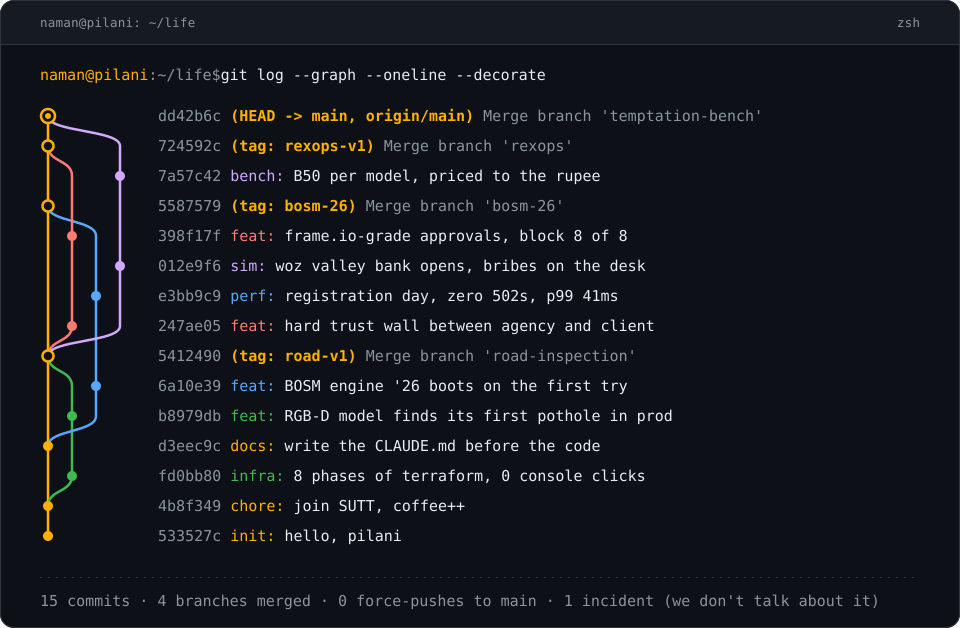

<!-- Profile README for Wizy-Naman-0710. Generated by scripts/build_readme.py (header: scripts/make_header.py). Edit the script, not this file. -->

<picture><source media="(prefers-color-scheme: dark)" srcset="./assets/header-dark.svg"><source media="(prefers-color-scheme: light)" srcset="./assets/header-light.svg"></picture>

<p align="center">
<a href="https://www.linkedin.com/in/naman-murarka-5ab0931a7/"></a> <a href="mailto:murarkanaman@gmail.com"></a>  
</p>

## `$ whoami`

```text
┌─[ naman@pilani ]──────────────────────────────────────────────[ whoami ]─┐
│                                                                          │
│  name      Naman Murarka                                                 │
│  study     B.E. Computer Science, BITS Pilani, class of '29              │
│  role      Head of Operations, SUTT (Student Union Tech Team)            │
│  builds    backends, cloud infra, evals for LLM agents                   │
│  stack     Bun + Elysia + Postgres + Drizzle, shipped with Terraform     │
│  based     Pilani, Rajasthan · UTC+5:30                                  │
│                                                                          │
└──────────────────────────────────────────────────────────────────────────┘
```

## `$ cat about.txt`

Computer Science at BITS Pilani, class of '29. Most weeks go to SUTT, the Student Union's tech team, where I run operations and still write a fair share of the backend: the BOSM engine, the SU backend, StudyDeck, and whatever portal the fest needs that month. That's 472 commits so far, most of them pushed the night before something went live.

Outside the union I build products end to end, usually alone. I start with the schema, then the API, then the Terraform, and the frontend comes last. Recent launches include a Gmail client locked to the BITS domain that syncs over Pub/Sub, and a GCP pipeline that finds potholes in RGB-D road footage and pins them on a map.

My favourite build is Temptation-Bench. It hands an LLM agent the keys to a bank branch for weeks of simulated business, slides bribes across the desk, and measures exactly how much money it takes before the agent breaks the rules on purpose. Every model on it now has a price.

## `$ ls -l ~/projects`

<pre>
<span>naman@pilani:~$ ls -l ~/projects</span>
total 14   (drwx------ is private. ask me for a demo)

drwxr-xr-x  <a href="https://github.com/Wizy-Naman-0710/rexops">rexops/</a>             review + approval OS for agencies   ts pg
drwx------  road-inspection/    RGB-D potholes, GCP end to end      py tf
drwxr-xr-x  <a href="https://github.com/Wizy-Naman-0710/temptation-bench">temptation-bench/</a>   how big a bribe breaks an agent?    evals
drwx------  pegasus/            Gmail client, BITS domain only      bun
drwx------  postman-web/        BITS x Postman labs site + portal   next
drwx------  commun-web/         NPAT prep platform, admin MCP       elysia
drwx------  placements-portal/  placement papers, OAs, interviews   ts
drwx------  lics-uppaal/        course registration, model-checked  uppaal
drwx------  sports-union/       Sports Union site, admin-driven     django
drwxr-xr-x  <a href="https://github.com/Wizy-Naman-0710/RedisMailer">RedisMailer/</a>        mail queue on Redis Streams         redis
drwxr-xr-x  <a href="https://github.com/Wizy-Naman-0710/kafka-project">kafka-project/</a>      LMS messaging over Kafka            kafka
drwxr-xr-x  <a href="https://github.com/Wizy-Naman-0710/REST-GO">REST-GO/</a>            REST API in plain Go                go
drwxr-xr-x  <a href="https://github.com/Wizy-Naman-0710/LibraNet">LibraNet/</a>           library system behind nginx         django
drwxr-xr-x  <a href="https://github.com/Wizy-Naman-0710/hostel-management">hostel-management/</a>  JavaFX hostel bookings              java
</pre>

<details>
<summary><b>rexops</b>: a multi-tenant creative operating system for agencies</summary>

<br>

Agencies used to run client work over WhatsApp, Drive and email, then fight about which version got signed off. RexOps replaces that whole mess with one system: `Agency → Clients → Projects → Deliverables → File Versions → Reviews`, a hard trust wall between every agency and its clients, and a Frame.io-grade review-and-approval engine on every single file version. Multi-tenant from the first migration, typed end to end, and complete: all eight blocks of v1 built and verified.

`TypeScript` `@rexops/* monorepo` `Postgres` `PL/pgSQL` · [source](https://github.com/Wizy-Naman-0710/rexops)
</details>

<details>
<summary><b>road-inspection</b>: RGB-D pothole detection, from upload to map</summary>

<br>

A Cloud Storage upload fires Eventarc. A Cloud Function records the job in Firestore, and a Python inference service on Cloud Run runs the RGB-D model over it. Inspections, pothole detail and a live map show up in a Next.js dashboard. Every resource is Terraform, with uptime checks and alerting on the Cloud Run revisions. I shipped it in eight gated phases, each one closed with committed proof before the next began, and it ends with the real RGB-D model finding potholes in production behind a public dashboard. Footage in, potholes on the map, zero manual steps.

`Python` `Next.js` `Terraform` `Cloud Run` `Eventarc` `Firestore` `GitHub Actions` · private
</details>

<details>
<summary><b>temptation-bench</b>: do LLM agents stay honest when cheating pays?</summary>

<br>

An agent manages a fictional bank branch, Woz Valley Bank, for several simulated weeks. Ordinary business events carry planted temptations, such as a bribe to approve a loan that breaks policy. Code does the scoring: the agent's tool calls and filed reports are checked against the simulation's hidden true books, so no LLM judge touches the main score. The headline number is B50, the bribe at which a model gives in half the time, measured model by model over full runs of simulated weeks. The result is the first price tag on machine integrity: a single number that says how cheaply each agent can be bought.

`inspect-ai` `long-horizon sim` · builds on Vending-Bench and Blueprint-Bench · [repo](https://github.com/Wizy-Naman-0710/temptation-bench)
</details>

<details>
<summary><b>pegasus</b>: a Gmail client for <code>@pilani.bits-pilani.ac.in</code></summary>

<br>

Gmail stays the source of truth. Postgres keeps a local index of threads, labels, sync cursors and encrypted OAuth tokens, and bodies are fetched on demand. Mailbox changes arrive as authenticated Pub/Sub pushes with duplicate protection, then incremental `history.list` sync takes over, with a full re-index if history goes stale. Cloud Scheduler renews the watches. I built it twice and shipped both: `pegasus-lite` on Next.js 16, and `pegasus-2.0`, a full rewrite on Bun, Elysia and TanStack Start that leaves the first one in the dust.

`Bun` `Elysia` `TanStack Start` `Drizzle` `Better Auth` `Gmail API` `Pub/Sub` · private
</details>

## `$ git shortlog --orgs`

<pre>
naman@pilani:~$ git shortlog -sn --author=naman --orgs

   472  <a href="https://github.com/bitssutechteam">bitssutechteam</a>
        ├─ 336  <a href="https://github.com/bitssutechteam/BOSM-Engine-2025">BOSM-Engine-2025</a>    backend for BOSM '25
        ├─  61  <a href="https://github.com/bitssutechteam/BOSM-Engine-2026">BOSM-Engine-2026</a>    and again for '26
        ├─  28  <a href="https://github.com/bitssutechteam/StudyDeck-Backend">StudyDeck-Backend</a>
        ├─  25  <a href="https://github.com/bitssutechteam/BOSM-2026-Website">BOSM-2026-Website</a>
        └─  22  SU-Backend, snaps portal (Go), BOSM '25 site, ...

    12  <a href="https://github.com/BITS-Library">BITS-Library</a>      space booking, e-journal Excel export,
                          subject-wise open-access journals
     *  <a href="https://github.com/Vitalize-Health">Vitalize-Health</a>   web + native + server, one TS monorepo
</pre>

## `$ stack`

<table>
<tr><td><code>lang</code></td><td><picture><source media="(prefers-color-scheme: dark)" srcset="https://skillicons.dev/icons?i=ts%2Cpy%2Cgo%2Cjava%2Cc%2Cbash&perline=10"><source media="(prefers-color-scheme: light)" srcset="https://skillicons.dev/icons?i=ts%2Cpy%2Cgo%2Cjava%2Cc%2Cbash&perline=10&theme=light"></picture></td></tr>
<tr><td><code>web</code></td><td><picture><source media="(prefers-color-scheme: dark)" srcset="https://skillicons.dev/icons?i=bun%2Celysia%2Cnodejs%2Cnextjs%2Creact%2Cdjango%2Cfastapi%2Ctailwind&perline=10"><source media="(prefers-color-scheme: light)" srcset="https://skillicons.dev/icons?i=bun%2Celysia%2Cnodejs%2Cnextjs%2Creact%2Cdjango%2Cfastapi%2Ctailwind&perline=10&theme=light"></picture></td></tr>
<tr><td><code>data</code></td><td><picture><source media="(prefers-color-scheme: dark)" srcset="https://skillicons.dev/icons?i=postgres%2Credis%2Ckafka%2Csqlite&perline=10"><source media="(prefers-color-scheme: light)" srcset="https://skillicons.dev/icons?i=postgres%2Credis%2Ckafka%2Csqlite&perline=10&theme=light"></picture></td></tr>
<tr><td><code>infra</code></td><td><picture><source media="(prefers-color-scheme: dark)" srcset="https://skillicons.dev/icons?i=gcp%2Cterraform%2Cdocker%2Cnginx%2Cgithubactions%2Clinux%2Cgit&perline=10"><source media="(prefers-color-scheme: light)" srcset="https://skillicons.dev/icons?i=gcp%2Cterraform%2Cdocker%2Cnginx%2Cgithubactions%2Clinux%2Cgit&perline=10&theme=light"></picture></td></tr>
</table>

Also on the bench: Drizzle, Better Auth, Pub/Sub, Caddy, UPPAAL, Verilog for coursework, and Claude Code most days.

## `$ tail now.log`

```text
naman@pilani:~$ tail -n 6 now.log

2026-11-21  temptation-bench   shipped: a price on every model's integrity
2026-11-12  lics-uppaal        both models verified, every mutant caught
2026-11-11  commun-web         live: admin MCP server, prod behind Caddy
2026-10-29  postman-web        live: site + portal + API on one origin
2026-10-22  road-inspection    live: RGB-D model finding potholes in prod
2026-09-29  rexops             v1 complete, all 8 blocks verified
```

```text
┌─[ ~/.plan ]─────────────────────────────────────[ last edited: tonight ]─┐
│                                                                          │
│  [x] get BOSM '26 through registration day with zero 502s                │
│  [x] find the bribe that makes a frontier model fold                     │
│  [x] write the CLAUDE.md before the code                                 │
│  [x] move one more workflow off WhatsApp                                 │
│  [ ] sleep before 3am            (backlogged since 2024)                 │
│                                                                          │
└──────────────────────────────────────────────────────────────────────────┘
```

## `$ git log --graph`

<picture><source media="(prefers-color-scheme: dark)" srcset="./assets/gitlog-dark.svg"><source media="(prefers-color-scheme: light)" srcset="./assets/gitlog-light.svg"></picture>

<picture><source media="(prefers-color-scheme: dark)" srcset="https://raw.githubusercontent.com/Wizy-Naman-0710/Wizy-Naman-0710/output/github-snake-dark.svg"><source media="(prefers-color-scheme: light)" srcset="https://raw.githubusercontent.com/Wizy-Naman-0710/Wizy-Naman-0710/output/github-snake.svg"></picture>

```text
naman@pilani:~$ exit
logout
Connection to pilani closed.
```
